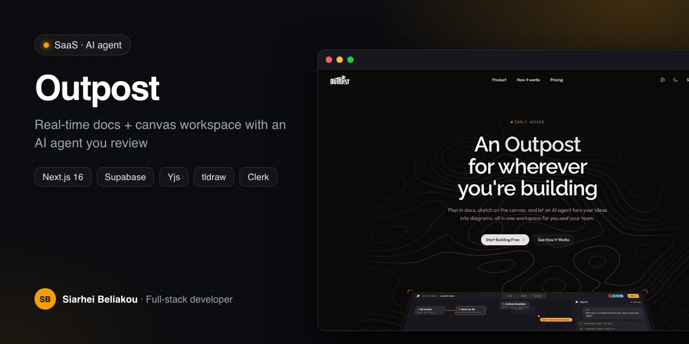
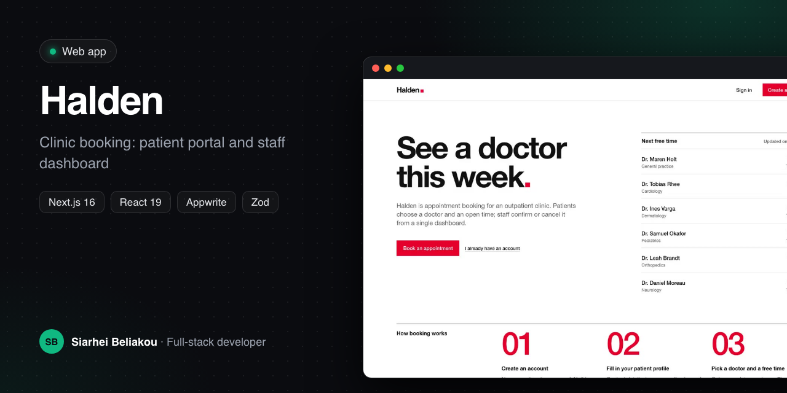
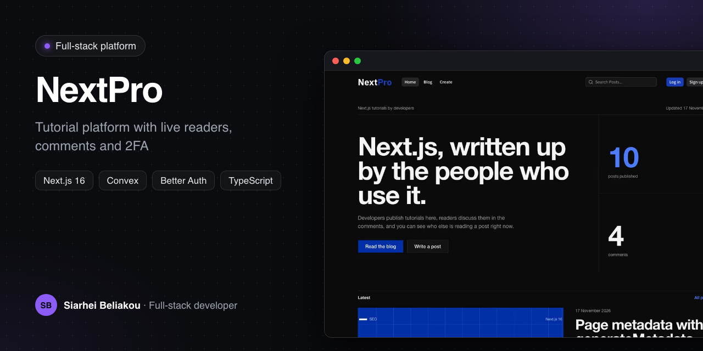
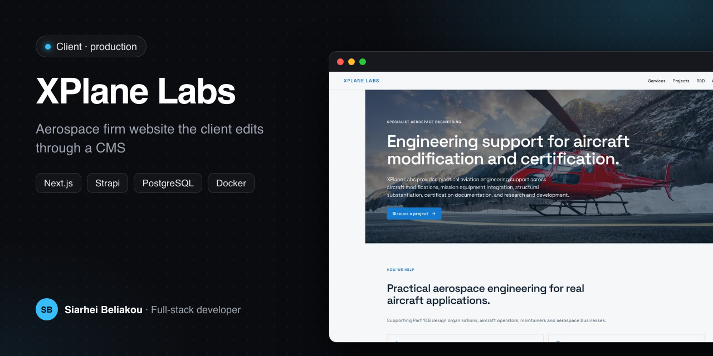
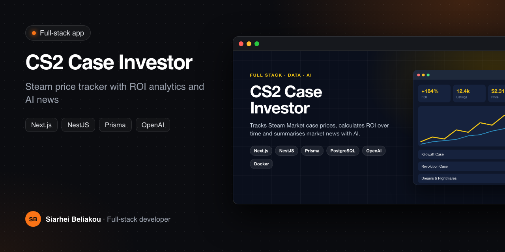
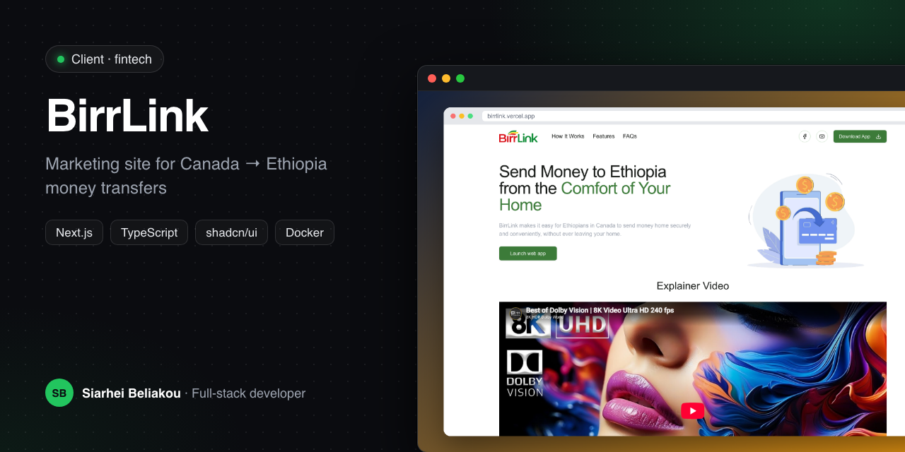
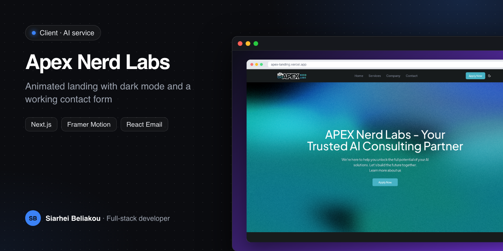
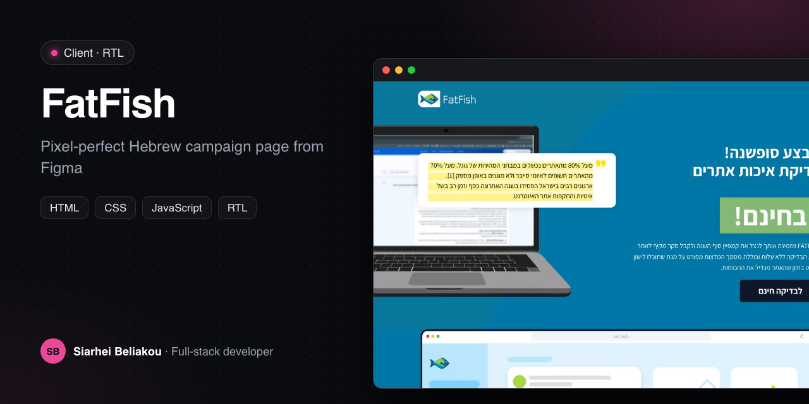

### Hi, I'm Siarhei 👋

Full-stack developer focused on **Next.js + Supabase SaaS**: multi-tenant apps, auth and roles, Stripe billing, real-time collaboration and AI agents. I take products from Figma or an idea to production and deploy them myself (Vercel, Docker, Nginx).

- 🚀 **SaaS products**: Next.js 16, TypeScript, Supabase / PostgreSQL with RLS, Clerk, Stripe
- 🤖 **AI features**: agents with tool calling and reviewable edits, OpenAI, Claude and Gemini APIs
- 🔄 **Real-time**: collaborative editing with Yjs, live presence, Supabase Realtime, Convex
- ⚙️ **Backends**: NestJS, tRPC, Prisma, Drizzle, headless CMS (Strapi)
- 🌍 Shipped production sites for clients in **New Zealand, Israel and Canada**
- 💼 **Open to freelance projects and full-time remote roles**

  
  
  
  

## Featured projects

<table>
<tr>
<td width="50%" valign="top"> <b><a href="https://github.com/srg201/outpost">Outpost</a></b> · <a href="https://outpost-gray.vercel.app">Live ↗</a> Real-time workspace: collaborative doc + infinite canvas + an AI agent whose edits you accept or reject · Next.js 16, Clerk teams &amp; billing, Supabase, Yjs, tldraw, Gemini</td>
<td width="50%" valign="top"> <b><a href="https://github.com/srg201/healthcare-platform">Halden: clinic booking</a></b> · <a href="https://healthcare-platform-fawn.vercel.app">Live ↗</a> Patient portal + staff dashboard, role-based access, double booking blocked at the database level · Next.js 16, React 19, Appwrite, tests + CI</td>
</tr>
<tr>
<td width="50%" valign="top"> <b><a href="https://github.com/srg201/nextpro">NextPro</a></b> · <a href="https://nextpro-rho.vercel.app">Live ↗</a> Tutorial platform with live readers, comments, full-text search and mandatory 2FA · Next.js 16 Cache Components, Convex, Better Auth</td>
<td width="50%" valign="top"> <b><a href="https://github.com/srg201/x-plane">XPlane Labs</a></b> · <a href="https://xplanelabs.nz">Live ↗</a> Production site for a New Zealand aerospace firm, fully editable by the client · Next.js, Strapi CMS, PostgreSQL, Docker + Nginx on a VPS</td>
</tr>
<tr>
<td width="50%" valign="top"> <b><a href="https://github.com/srg201/csgo-investing-app">CS2 Case Investor</a></b> Steam Market price history, ROI from any purchase date and AI news summaries · Next.js + NestJS + Prisma + PostgreSQL, Docker</td>
<td width="50%" valign="top"> <b><a href="https://github.com/srg201/birrlink">BirrLink</a></b> · <a href="https://birrlink.vercel.app">Live ↗</a> Marketing site for a Canada → Ethiopia money transfer service · Next.js, TypeScript, shadcn/ui, Docker</td>
</tr>
<tr>
<td width="50%" valign="top"> <b><a href="https://github.com/srg201/apex-landing">Apex Nerd Labs</a></b> · <a href="https://apex-landing.vercel.app">Live ↗</a> Design + development for a client's AI service: Framer Motion, dark mode, branded emails from the contact form · Next.js, React Email</td>
<td width="50%" valign="top"> <b><a href="https://github.com/srg201/fatfish">FatFish</a></b> · <a href="https://www.fatfish.co.il/campaign/2025audit">Live ↗</a> Pixel-perfect RTL (Hebrew) campaign page for an Israeli web agency, Figma to code · HTML, CSS, JavaScript</td>
</tr>
</table>

## Tech stack

**Frontend** 
       

**Backend** 
           

**DevOps and tools** 
     

---

Have a project in mind? Email me at <a href="mailto:belyakov329@gmail.com">belyakov329@gmail.com</a> or message me on <a href="https://linkedin.com/in/sergey-belyakov-1b7641349">LinkedIn</a>.
