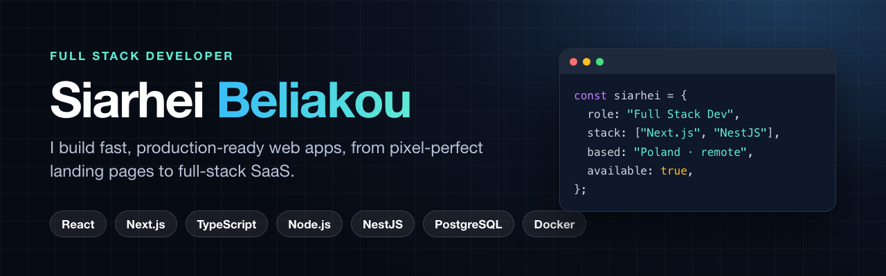

### Hi, I'm Siarhei 👋

I'm a full-stack developer working mostly in **React / Next.js** on the frontend and **Node.js / NestJS** on the backend. I build landing pages, SaaS MVPs, dashboards and APIs, and I deploy them myself with Docker, Nginx and Vercel.

- 🧩 I turn Figma designs into fast, responsive, pixel-perfect interfaces
- ⚙️ I build typed backends with NestJS, Prisma, Drizzle, tRPC and PostgreSQL
- 🤖 I add AI features to products with the OpenAI API
- 🌍 I've shipped production sites for clients in New Zealand, Israel and Canada
- 💼 **Open to freelance projects and full-time roles**

  
  
  

## Tech stack

**Frontend** 
       

**Backend** 
        

**DevOps and tools** 
     

## Featured projects

<table>
<tr>
<td width="50%" valign="top"> <b><a href="https://github.com/srg201/x-plane">XPlane Labs</a></b> · <a href="https://xplanelabs.nz">Live</a> Client site for a NZ aerospace firm · Next.js + Strapi CMS + PostgreSQL · Docker/Nginx on VPS</td>
<td width="50%" valign="top"> <b><a href="https://github.com/srg201/youtube-clone">Video Sharing Platform</a></b> Mux streaming, creator studio, subscriptions, AI-generated metadata · Next.js 15, tRPC, Drizzle, Clerk</td>
</tr>
<tr>
<td width="50%" valign="top"> <b><a href="https://github.com/srg201/healthcare-platform">CarePulse Healthcare</a></b> · <a href="https://healthcare-platform-fawn.vercel.app">Live</a> Patient onboarding, booking, admin dashboard and SMS · Next.js, Appwrite, Twilio</td>
<td width="50%" valign="top"> <b><a href="https://github.com/srg201/csgo-investing-app">CS2 Case Investor</a></b> Steam Market price tracking, ROI analytics, AI news · Next.js + NestJS + Prisma</td>
</tr>
<tr>
<td width="50%" valign="top"> <b><a href="https://github.com/srg201/apex-landing">Apex Nerd Labs</a></b> · <a href="https://apex-landing.vercel.app">Live</a> AI service landing page · design + dev, Framer Motion, React Email contact form</td>
<td width="50%" valign="top"> <b><a href="https://github.com/srg201/birrlink">BirrLink</a></b> · <a href="https://birrlink.vercel.app">Live</a> Money transfer (Canada → Ethiopia) marketing site · Next.js, shadcn/ui</td>
</tr>
</table>

<b>More work</b>

- [FatFish](https://github.com/srg201/fatfish): pixel-perfect RTL (Hebrew) campaign page for an Israeli agency · [live](https://www.fatfish.co.il/campaign/2025audit)
- [HooBank](https://github.com/srg201/HooBank): fintech landing page · React, Vite, Tailwind · [live](https://hoo-bank-rouge-five.vercel.app)
- [GPT-3 Landing](https://github.com/srg201/gpt3-landing): AI product landing page · React, Sass · [live](https://gpt3-landing-peach.vercel.app)

## GitHub stats

---

Have a project in mind? Email me at <a href="mailto:belyakov329@gmail.com">belyakov329@gmail.com</a> or message me on <a href="https://linkedin.com/in/sergey-belyakov-1b7641349">LinkedIn</a>.
